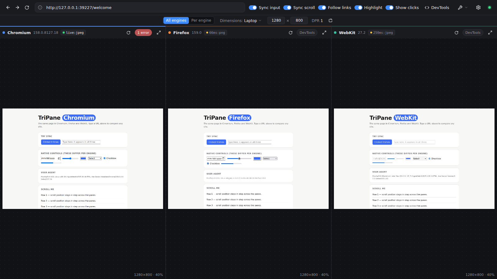
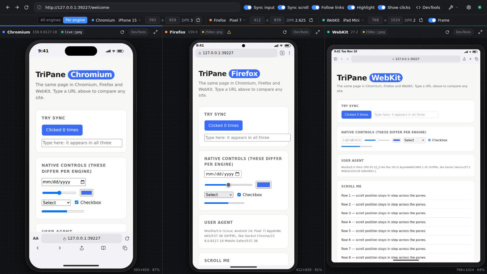

# TriPane

**One page, three real browser engines, side by side, for free.**

TriPane opens any URL in **Chromium, Firefox and WebKit at the same time**, in one window. Click,
type, scroll or navigate in one, and the other two follow. When something looks or behaves
differently in one engine, you see it immediately, without switching between three browsers.

- **No subscription, no payments, no account.** There's no trial that runs out, no license key,
  no sign-in and no usage limits. You download it and use it.
- **Everything runs on your machine.** The three engines run locally (they're [Playwright](https://playwright.dev)'s
  builds), not in a cloud you pay for by the minute. Your pages, logins and history stay on your
  computer.



## Three engines, not three windows of the same browser

Most "responsive" and multi-device developer browsers show many panes, but every pane is
Chromium. That catches layout problems at different sizes, but not the bugs that come from
**different rendering engines**. TriPane runs the three engines behind practically every browser in use:

| Engine | What it stands for | Catches |
| --- | --- | --- |
| **Chromium** (Blink) | Chrome, Edge, Opera, Brave, Samsung Internet | The baseline most sites are built against |
| **Firefox** (Gecko) | Firefox | Gecko's own layout, form controls and CSS support |
| **WebKit** | Safari on macOS, and **every browser on iPhone and iPad** | Safari-only bugs, the ones you usually find on a real iPhone |

They're the patched engine builds Playwright ships, close to the browsers they come from but not
identical: for the final word on a Safari-only bug, a real Apple device still wins.

### Compared with similar tools

| | Engines | Cost |
| --- | --- | --- |
| **TriPane** | **Chromium, Firefox and WebKit together** | **Free** |
| Polypane, Sizzy | Chromium only (many sizes at once) | Paid subscription |
| Responsively App | Chromium only | Free |
| BrowserStack, LambdaTest | Real browsers and devices, one session at a time, in the cloud | Paid plans |

(These products change; check their sites for the current details.)

## Getting started

Needs [Bun](https://bun.sh) 1.4 or later (`curl -fsSL https://bun.sh/install | bash`).

```sh
bun install    # also downloads the three engines (about 500 MB, once)
bun start      # opens the TriPane window
```

On Linux, Firefox and WebKit also need some system libraries. Install them once with:

```sh
sudo bunx playwright install-deps chromium firefox webkit
```

Or use a **standalone build**: one executable with everything inside, no Bun or Node needed (see
[Standalone builds](#standalone-builds)). On first start it downloads the engines.

## What you can do

### See differences
- **Synced panes:** clicks, typing, paste, hover, scrolling and navigation in one pane are replayed
  in the others. Scrolling syncs by percentage, so pages of different lengths stay in step.
  Follow links takes the other panes along when one navigates on its own.
- **Highlight:** hovering an element outlines the same element in all three engines, with margin,
  border and padding, so size and position differences stand out.
- **Compare element:** pick any element to see its box model and every computed style from the
  three engines side by side, with the differing values highlighted. Each property shows its
  [Baseline](https://web.dev/baseline) status, and an engine is flagged when its version doesn't
  support the property or value ("not in Safari", "Firefox 154+"), using MDN's compatibility data.
- **Compare engines:** the whole page against a reference engine.
  - **Visual:** a pixel diff per engine (ignoring text anti-aliasing), shown as Diff, Swipe or Side by side, with a "% different" figure.
  - **Accessibility tree:** each engine's roles, names and states, as a line diff.
- **Network figures:** the address bar shows each engine's load time; click it for requests,
  bytes transferred, failed requests, first byte, DOMContentLoaded and load per engine, with the
  best value marked. Measured from each engine's network events; nothing runs in the page.
- **All consoles:** every engine's console in one timeline, formatted the same way. Messages only
  some engines logged are flagged ("only in WebKit").

### Test devices and sizes
- **Device bar** (like Chrome's device mode): Responsive sizes or phones and tablets (iPhone 15, iPhone SE, Pixel 7, Galaxy S24, iPads, Galaxy Tab), with pixel ratio, touch, mobile mode and user agent. Rotate, or type a size.
- **Per engine:** give each engine its own size or device. For example, Chromium as an iPhone, Firefox as a Pixel and WebKit as an iPad.
  Synced clicks then go to the same element in each, not the same x,y.
- **Device frames:** a phone or tablet body with imitation browser bars (Safari's address bar,
  Dynamic Island, Chrome's toolbar) around emulated devices. They're drawn around the page, never over it.



### Inspect and debug
- **Chrome DevTools for every engine:** the real Chrome DevTools, docked or in its own window, for
  Chromium natively and for Firefox and WebKit through TriPane's adapter (Console, Elements, Styles,
  Network). See [DevTools](#devtools).
- **Site info:** each engine's view of the connection and certificate, cookies, storage and
  permissions, and clearing one site's data in every engine.
- **Reload one engine** and bring it back in step; **turn engines off** to save memory.
- **Screenshot all:** full-page PNGs from every engine in one click.
- **Record trace** (Tools menu): a [Playwright trace](https://playwright.dev/docs/trace-viewer) per
  engine, with every navigation, click and key press, a DOM snapshot before and after each one,
  screenshots, network and console. Stop it from the timer in the toolbar, then open each engine's
  trace in Playwright's Trace Viewer, served by TriPane itself. TriPane's own calls (picture capture,
  hover, scroll sync) are left out, so the trace shows only what you did. Traces go to `traces/`
  (`~/.tripane/traces` for standalone builds). They hold the pages' content, network responses and
  cookies, so share them with care.

### Everyday browsing
- **Address bar** with history and inline autocomplete, and a **History** page (Ctrl+H) with search, filters and bulk delete.
- **Saved logins:** each engine's cookies and storage are kept between runs (or use `--no-persist`).
- **Themes:** TriPane Light/Dark, GitHub, Dracula, VS Code Light/Dark Modern; light or dark pages.
- **Proxy:** send all three engines through mitmproxy, Charles or a corporate proxy.

### For AI agents
TriPane is an [MCP](https://modelcontextprotocol.io) server: an agent like Claude Code can open
pages, click and type in all three engines, take screenshots, read the consoles and run the
comparisons, while you watch it happen in the window. See [AI agents (MCP)](#ai-agents-mcp).

## Privacy: what leaves your machine

TriPane has no telemetry, no analytics and no account. Apart from the pages you open, it
contacts:

- **Engine updates:** shortly after start and then daily, `registry.npmjs.org` and
  `cdn.jsdelivr.net` to see whether newer engine builds exist. Nothing about you or your pages is
  sent. Turn it off in Settings → Engine updates.
- **Site icons:** for the History page and address bar, TriPane fetches the icons of sites you've
  visited (the same files the engines load anyway).
- **First start of a standalone build:** downloads the engine builds from Playwright's servers.

The server listens only on `127.0.0.1`, and the UI, DevTools and MCP endpoints need a random
per-run token.

## Command-line options

`bun start <options>`, or `tripane <options>` for a standalone build.

| Option | |
| --- | --- |
| `--url <url>` | First page to open (default: a built-in welcome page that works offline) |
| `--port <n>` | Port for the UI server (default: random) |
| `--profile <dir>` | Where cookies, storage, history and settings are saved (default `~/.tripane/storage`) |
| `--no-persist` | Fresh session: load and save nothing |
| `--no-window` | Don't open a window; print the URL to open in any browser |
| `--proxy <url>` | Route all engines through a proxy: `host:port`, `http://[user:pass@]host:port`, `https://…`, `socks4://…`, `socks5://…` |
| `--proxy-bypass <hosts>` | Comma-separated hosts or ranges that skip the proxy |
| `--proxy-loopback` | Send `localhost` through the proxy too (by default it goes direct) |
| `--ignore-cert-errors` | Accept any HTTPS certificate (for proxies that re-sign traffic, like mitmproxy) |
| `--dev` | Hot-reload the UI (`bun run dev`) |
| `-v`, `--version` | Print the version |
| `install`, `install-deps` | Download the engines; install their Linux system libraries (uses sudo) |
| `mcp` | Run as an MCP server on stdin/stdout (opens the window too; add `--no-window` to hide it) |

**HTTPS through an inspecting proxy:** mitmproxy re-signs every site with its own certificate
authority, which the engines don't trust. Pass `--ignore-cert-errors` or install mitmproxy's CA.
While a proxy is in use, site info shows the proxy's certificate and says so. Proxied traffic
can't use HTTP/3.

## AI agents (MCP)

**Let the agent start TriPane** (stdio):

```sh
claude mcp add tripane -- bun /path/to/tripane/server/main.ts mcp
claude mcp add tripane -- tripane mcp            # standalone build
```

**Or attach to a running TriPane** (HTTP). At startup it prints
`MCP endpoint for AI agents: http://127.0.0.1:<port>/mcp?token=…`; use `--port` for a fixed address:

```sh
bun start --port 4500
claude mcp add --transport http tripane "http://127.0.0.1:4500/mcp?token=<token>"
```

The token can also go in an `Authorization: Bearer <token>` header. The status dot at the right of
the toolbar shows the endpoint and copies it.

| Tool | What it does |
| --- | --- |
| `status` | Each engine's version, URL, title, load state, viewport, device, error count and network figures |
| `navigate`, `history`, `reload_engine` | Open a URL; back, forward, reload; reload one engine and resync it |
| `screenshot` | One image per engine: viewport, full page or one element |
| `click`, `fill`, `press_key`, `scroll` | Act on a selector in every engine (or the ones named) |
| `evaluate` | Run JavaScript in each engine and get the results as JSON |
| `compare_element` | Box model and the computed styles that differ, for a selector |
| `visual_diff` | % of pixels that differ from a reference engine, plus diff images |
| `aria_diff` | Each engine's accessibility tree compared with a reference, as a line diff |
| `console` | The combined console, filtered by level, engine or id |
| `emulate` | Size, device or color scheme, for all engines or per engine |
| `site_info` | Connection, certificate, cookies, storage and permissions per engine |
| `performance` | Performance monitor figures. In every engine: DOM nodes, frames, paint timings and network figures. Chromium only: CPU usage, JS heap, event listeners, layouts and style recalculations per second, sampled over `sample_ms`. Text or JSON output |

## DevTools

Every engine reports to the same tool, Chrome DevTools (F12):

| | Chromium | Firefox, WebKit |
| --- | --- | --- |
| Connection | Chromium's own DevTools socket | TriPane's CDP adapter (`server/cdp/`) |
| Console | ✓ | ✓ Logs, errors, evaluation, expandable objects, `$0` / `$` / `$$` / `$x` |
| Elements | ✓ | ✓ Live DOM tree, picker, highlight, search, editing |
| Styles | ✓ | ✓ Matched, inline, inherited and computed styles, live editing |
| Network | ✓ | ✓ Requests, headers, status, timing, sizes, bodies |
| Sources | ✓ | Read-only list of scripts and stylesheets |
| Debugger, Performance, Memory, Lighthouse | ✓ | Chromium only |

Dock it at the left, bottom or right, or pop it out into its own window. Its tabs switch between All
consoles, each engine, and Compare.

TriPane sets two DevTools preferences for every engine:
- Pasting into the Console and Sources works straight away, without first typing "allow pasting".
- "Match Chrome color scheme" is off, so DevTools uses its own colors.

They're set again on every start; changes made in DevTools' Settings last until TriPane quits.

## Standalone builds

`bun run dist` compiles TriPane into **one executable**: server, UI and Playwright inside, no Bun,
Node or `node_modules` needed.

```sh
bun run dist                        # this machine's platform
bun run dist --all                  # linux-x64, linux-arm64, darwin-x64, darwin-arm64, windows-x64
bun run dist --target darwin-arm64  # specific targets (repeatable)
```

- Output: `dist/tripane-<version>-<target>.tar.gz` (the `tripane` binary, a `README.txt` and `icon.png`; on Linux also a `tripane.desktop` launcher), plus `dist/SHA256SUMS`. About 110 MB per binary, 40–55 MB compressed.
- The Windows `tripane.exe` carries the TriPane icon and version details, set by the build on any platform (`scripts/windows-resources.ts`).
- The engines aren't embedded (they're about 500 MB together). The first start downloads them to Playwright's shared cache; `tripane install` does that on its own, and `sudo tripane install-deps` installs Linux system libraries.
- Data goes to `~/.tripane/` (storage, screenshots and traces).
- Only `linux-x64` has been run and tested; the other targets compile but are untested. macOS binaries aren't signed or notarized, so Gatekeeper blocks them until the quarantine flag is removed (the archive's README says how).

### Releases (GitHub Actions)

`.github/workflows/release.yml` builds every target on its own platform and publishes a GitHub Release.

To release, bump `"version"` in `package.json`, commit and push. Then either:

- **From GitHub:** Actions → Release → *Run workflow*, with **Publish a release** ticked. The release is tagged `v<version>` on the commit that was built.
- **From a tag:** `git tag v0.3.0 && git push origin v0.3.0`. The tag must match `package.json`.

What the workflow does:

1. **Check:** a version that was already released is refused. Then typecheck and the full test suite (with Playwright's browsers).
2. **Build:** one job per target on a native runner (Linux x64/arm64, macOS Intel/Apple silicon, Windows). Each one also runs its binary's `--version` as a smoke test.
3. **Release:** the archives and a `SHA256SUMS` file, with notes generated from the commits since the last release. Versions with a hyphen (`0.3.0-beta.1`) become pre-releases.

*Run workflow* without **Publish a release** runs steps 1 and 2 only. The archives are then kept as workflow artifacts for 14 days and no release is made.

## How it works

```
App window (Playwright's Chromium in --app mode)
   │  Preact UI ⇄ WebSocket (JPEG/PNG frames ⇄ input and commands)
   ▼
Bun server: serves the UI, runs the engines
   ├─ Chromium (headless) ─┐
   ├─ Firefox  (headless) ─┼─ one PaneSession each
   └─ WebKit   (headless) ─┘
```

- **Pictures:** Chromium streams through its screencast, pushed on every repaint. Firefox and WebKit have no screencast API, so the server polls screenshots: about 15 fps while the page changes, 4 fps when idle, skipping unchanged frames. Settings → Frame format picks JPEG or PNG per engine.
- **Input:** each pane is a canvas. Pointer, wheel and keyboard events are mapped to page pixels and replayed with Playwright, in order, per engine.
- **Stack:** [Bun](https://bun.sh) (server, bundler, tests; no build step), [Playwright](https://playwright.dev), [Preact](https://preactjs.com), [Tailwind CSS v4](https://tailwindcss.com), [Lucide](https://lucide.dev) icons, [pixelmatch](https://github.com/mapbox/pixelmatch), and MDN's [browser-compat-data](https://github.com/mdn/browser-compat-data) and [web-features](https://github.com/web-platform-dx/web-features).
- **The page is left alone:** TriPane reads pages through Playwright's API and avoids injecting scripts or styles; the few exceptions, and why, are listed in [`CLAUDE.md`](CLAUDE.md).

| Where | What |
| --- | --- |
| `server/main.ts` | Command line, window, MCP over stdio |
| `server/server.ts` | HTTP and WebSocket server, sync, settings, message handling |
| `server/pane.ts` | One engine: browser, picture stream, input, events |
| `server/cdp/` | DevTools adapter for Firefox and WebKit |
| `server/mcp.ts` | MCP server and tools |
| `server/engine-diff.ts` | Visual and accessibility-tree diffs |
| `server/trace-viewer.ts`, `server/quiet.ts` | Record trace: serving Playwright's Trace Viewer, and keeping TriPane's own calls out of traces |
| `server/perf.ts` | The MCP `performance` tool: CDP Performance metrics (Chromium), DOM counts and paint timings (all engines) |
| `server/history.ts`, `server/storage.ts`, `server/proxy.ts` | History and site icons, saved logins and settings, proxy options |
| `shared/protocol.ts` | Messages between server and UI |
| `ui/src/` | The Preact UI (toolbar, panes, device bar and frames, DevTools dock, dialogs) |
| `scripts/` | `build-dist.ts` (standalone builds), `windows-resources.ts` (exe icon), `gen-icons.ts` (app icons), `gen-compat.ts` (CSS support data) |
| `assets/` | The app icon: `icon.svg` (the source, also the UI's favicon), `icon.png`, `icon.ico` |
| `test/` | End-to-end tests against the real engines |

## Development

```sh
bun run dev        # UI hot-reloads, server restarts on change
bun test           # end-to-end tests: launches all three engines
bun run typecheck
bun run compat     # rebuild shared/css-compat.json after updating the MDN data packages
bun run icons      # re-render assets/icon.png and icon.ico after changing assets/icon.svg
TRIPANE_CDP_DEBUG=1 bun start   # log DevTools commands the Firefox/WebKit adapter doesn't support
```

## Limitations

- **Playwright's engines aren't the shipping browsers.** WebKit is close to Safari but not identical; check Safari-only bugs on a real Apple device before shipping. TriPane says so once, on first start (the notice is remembered in `settings.json`).
- **Matching elements across engines** (Highlight, Compare, synced clicks at different sizes) follows the element's position in the DOM. If a page builds different DOM per engine, a match can miss.
- **Firefox has no mobile mode**, so it ignores a page's meta viewport under device emulation (its pane shows a ⚠). Touch detection also differs: only Chromium sets `navigator.maxTouchPoints`, and only WebKit has `window.ontouchstart`.
- **Smoothness:** Firefox and WebKit panes use screenshot polling, so animation and video look choppier there than in Chromium. Panes show CSS-pixel pictures, not high-DPI ones, though pages behave as on the device, and Screenshot all captures at full resolution.
- **Native dialogs and pickers** (`alert`, file pickers, `<select>` menus) open inside the headless engine and don't appear in the pane. IME composition isn't forwarded.
- **Device frames are an imitation:** the page doesn't react to the drawn notch, because safe-area insets aren't emulated.
- **Backspace never navigates back** in the panes. Playwright's WebKit still does that on Windows and macOS, so there TriPane doesn't send WebKit a Backspace unless the focus is in a text field (checked without injecting anything). Typing is unaffected, but a page's own Backspace shortcut outside text fields doesn't fire in WebKit on those platforms.
- **Interface theme in another browser** (`--no-window`): an explicit Light or Dark theme applies to TriPane's UI only; DevTools follows that browser's own preference. Use System to keep them matched.
